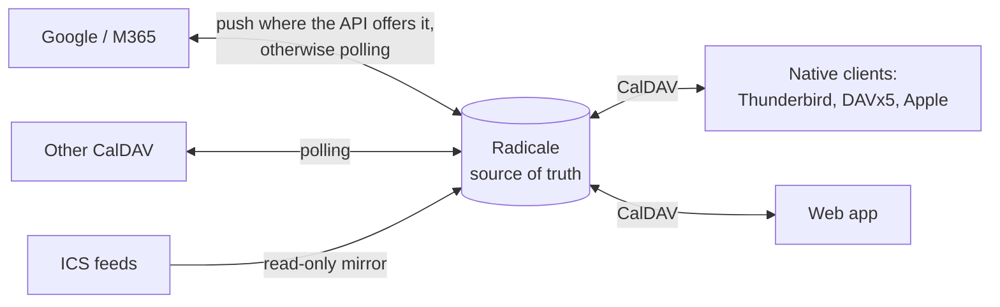

# CONCEPTS

The theory this calendar is built on: what it is for, the rules that span modules, and what was ruled out. Each statement is meant to be checkable against the code; where the code does not (yet) do what is written, the statement is the target and the gap is listed under *Known drift*. Statements the code cannot vouch for carry a provenance marker. Recorded in the first repo-wide pass (bootstrap, 2026-10-12/13); module-level files follow in pass two.

## What the program is for

The calendar is a FreeShard app: it runs inside one user's shard, next to the shard's own CalDAV server (Radicale), and gives the shard's people one place for all their calendars and tasks. A shard has an owner (the shard admin) and members — a family or a small team — who sign in through the shard's OIDC provider. *(Confirmed 2026-10-12.)*

**Radicale is the source of truth.** Every calendar a user sees lives in the shard's Radicale. External accounts — Google, Microsoft 365, Nextcloud, mailbox.org and other CalDAV servers — are *mirrored* into Radicale and synchronised in both directions; they are never read live by the web app. Disconnecting an external account stops the mirror and leaves the local copy in place, so a user can leave a provider and keep working with nothing lost. The same holds for a single linked calendar. The kept copy is a normal shard calendar, labelled with its former provider ("früher Google"), and goes to the trash like any other when deleted; nothing is deleted at the provider. Linking the same account again offers to re-attach the kept calendars, and the sync then resumes in them instead of mirroring a second copy (#614). For the user, all calendars behave the same regardless of where they came from. *(Confirmed 2026-10-12 — "verbindung zu google trennen und der shard kalender … soll dann einfach weiterlaufen".)*

Synchronisation with a provider uses push notifications wherever the provider's protocol offers them (Google Calendar and Microsoft Graph webhooks) and polling on an interval otherwise (plain CalDAV). *(Confirmed 2026-10-12.)*

**Devices talk CalDAV to the shard directly.** Native clients are first-class; the web app is one client among several, not a gateway. Clients are set up by pairing (QR / magic link, #352, #102). Push to clients (WebDAV-Push, as used by Nextcloud and DAVx5 — https://github.com/bitfireAT/webdav-push) is wanted where feasible; Radicale's support for it is unverified. *(Confirmed 2026-10-12; feasibility open.)*

**The business feature set stays and is finished, not trimmed:** resources, delegation, booking pages, out-of-office with automatic decline, natural-language quick entry with a UI, a task board, a second time zone, keyboard shortcuts. *(Confirmed 2026-10-12.)*

## Invariants spanning modules

**Identity.** Per-user data is keyed by the user id: in `AUTH_METHOD=oidc` that is the OIDC `sub` itself, in env mode `CALDAV_USERNAME`. Radicale collection roots (`/<user id>/`), internal calendar ids and the Radicale auth/rights plugins all use it; a display name (`preferred_username`) never names or opens a collection, and neither does `X-Ptl-Client-Id`, which identifies a device, not a person. A `sub` that is not safe as a single path segment is refused with 401, never rewritten; an unsafe `CALDAV_USERNAME` stops the start-up (#536). *(Confirmed 2026-10-15 — no existing installations, so no alias or migration; see #144, #331.)*

**One permission matrix.** Sharing and delegation are a single model: person × calendar × level. Delegation is the highest per-calendar level, above read and write. Whoever holds delegation on a person's *default* calendar may answer that person's invitations and acts for them in scheduling (including out-of-office declines). Delegation needs no acceptance; the delegate is informed and can drop it. There is no second, person-wide delegation concept. *(Confirmed 2026-10-13 — chosen over a separate person-wide model such as CalDAV proxy groups.)*

**Resources belong to the shard.** Only the shard admin creates and manages rooms, equipment and vehicles; every member can book them. A resource never belongs to the member who created it, so it cannot be orphaned when that member leaves. *(Confirmed 2026-10-13.)*

**Sync conflicts between the shard and a provider: the newer change wins, and the losing version is kept.** Every overwritten version is stored and can be restored by the user; the web app shows a notice (in-app and Web Push). Conflicts between a native client and Radicale are left to CalDAV's ETag precondition (RFC 4791 — https://www.rfc-editor.org/rfc/rfc4791). *(Confirmed 2026-10-13.)*

**ICS/webcal subscriptions are real calendars.** A subscribed feed is mirrored into Radicale as a read-only calendar, so every device sees it. The mirror is exact: an event removed from the feed is removed locally. The refresh interval is chosen per subscription, with a floor of 15 minutes, and fetching must never trip the source's rate limits: conditional requests (ETag / Last-Modified), honouring `429` and `Retry-After` with backoff, jitter between subscriptions, and the feed's own `REFRESH-INTERVAL` (RFC 7986 — https://www.rfc-editor.org/rfc/rfc7986) as the suggested default. *(Confirmed 2026-10-13.)*

**Recurring tasks repeat either on a fixed rhythm or from completion, chosen per task.** Fixed rhythm is the default and is stored as a standard RRULE (RFC 5545 — https://www.rfc-editor.org/rfc/rfc5545). "Repeat from completion" has no standard representation; the shard advances the due date when the task is completed, so a task completed in a native client moves on the next sync. *(Confirmed 2026-10-13.)*

**Offline, the web app reads and never writes.** It is an installable PWA that caches the last state, refreshes on every open, on every reminder push and through Periodic Background Sync where the browser offers it, and always states how old the shown data is ("offline, Stand Di 14:32"). It asks to be installed, because Safari evicts the storage of a site opened only as a tab after seven days of disuse. Up-to-date offline data is promised only through a native client. *(Confirmed 2026-10-13.)*

**Language and form of address.** Three UI languages: Deutsch (Du), Deutsch (Sie), English. The choice is resolved in this order: the user's calendar setting, the platform preference (freeshard#168), the browser, then Deutsch (Du). The same order resolves week start, 12/24 h and time zone. A test fails if any string that addresses the user is missing from either German variant, so Du and Sie can never mix on one screen. German copy is gender-neutral (#168). Dates and times are formatted with `Intl`, not hand-written arrays. *(Confirmed 2026-10-13.)*
Fallback until shard_core offers the platform preference (#625): week start, 12/24 h and time zone go straight from the user's calendar setting to the browser — the conventions of the browser's region within the UI language (`navigator.language` "de-AT" → de-AT; a browser in another language gets the UI language's, so a German screen never shows a 12 h clock nobody chose) and the browser's `Intl` time zone. The time zone setting is the zone new events are created in; the grids lay out hours in the browser's zone. All-day dates are local calendar dates (`YYYY-MM-DD`), never the UTC date of an instant.

**Design.** The tokens of FreeShard's design guide ("Daylight Instrument", v0.1 working draft, `../design-guide.pdf`) are binding: colours light and dark, Inter and IBM Plex Mono, spacing, radii, no shadows, outline-only buttons and pills, amber only for the one forward action per view. Fonts are served by the shard, never from a font CDN. What the guide does not cover — event colours, dense month/week grids, pickers, dialogs, mobile layouts — is decided in `DESIGN.md` in this repo; events are drawn as a tinted fill with a coloured left edge. When the guide is revised, the calendar follows it. *(Confirmed 2026-10-13.)*

**Nothing leaves the shard without consent.**
- Telemetry is off by default and sent only after the user has seen a clear warning and explicitly agreed.
- The calendar never sends tracking pixels or read receipts in outgoing mail or invitations.
- Remote content in incoming events (images, tracking pixels in HTML descriptions) is blocked until the user allows it.
- Every third-party service that receives shard data — address lookup, maps, weather — is off until enabled per service, with a statement of what is sent where.
- Accounts the user connected deliberately (Google, M365, CalDAV) are exempt; connecting them was the consent.
*(Confirmed 2026-10-13.)*

**No advertising and no upsell hints, ever** — the design guide's "calm when idle, no badges, tips or upsells". *(Confirmed 2026-10-13.)*

**Fail fast.** Missing secrets or configuration stop the service at start-up; errors are never masked by empty lists or dummy objects; security paths are tested under production semantics. Every CalDAV request sends `Accept-Encoding: identity`, and TLS exceptions for Radicale's self-signed certificate are scoped to that host. (From `CLAUDE.md`; enforced by tests and review.)

## Planned capabilities and their providers

These were asked for in the bootstrap session and shape the boundaries above; they are not built yet.

**Address autocomplete with map preview** (built, #512), provider chosen by the user: off (default), OpenStreetMap, or Google. The OSM variant uses Photon (https://github.com/komoot/photon), which is built for search-as-you-type; Nominatim's public instance forbids autocomplete (https://operations.osmfoundation.org/policies/nominatim/). The server address is a setting. While a shard is hosted by FreeShard, FreeShard may run one shared Photon instance and hold the Google API key for all hosted shards; a self-hosted shard brings its own Photon server or Google key. *(Confirmed 2026-10-13.)*

**Holidays** are computed locally from an open rule library — no external call. School holidays come from official ICS feeds, as subscriptions. **Weather** uses an open source (Bright Sky / DWD for Germany — https://brightsky.dev/; Open-Meteo is free only for non-commercial use — https://open-meteo.com/en/terms — so a hosted offering needs a subscription or a self-hosted instance) and is opt-in because it sends a location. *(Confirmed 2026-10-13.)*

**Contacts** come from the shard's own CardDAV address book (Radicale), not Gravatar: attendee autocomplete, photos, birthdays. Whether contacts become a separate FreeShard app is open. *(Confirmed 2026-10-13; placement open.)*

## Ruled out

- Live, non-mirrored external accounts (reading Google or CalDAV directly from the web app). Ruled out by "Radicale is the source of truth".
- A separate, person-wide delegation model next to sharing.
- Member-owned resources.
- Silently discarding the losing side of a sync conflict, and a "shard always wins" rule.
- A "conflicts" calendar to surface conflicts in native clients.
- Editing in the web app while offline (outbox queue).
- Webcal subscriptions held only in the app database.
- Sending tracking pixels; advertising; upsells; loading fonts or other assets from third-party CDNs.

## Modules

| Module | Responsibility |
| :--- | :--- |
| `server/index.js` | Process start-up and the middleware pipeline: sessions, CSRF, auth gateways, health checks. |
| `server/routes/auth.js` | Sign-in through the shard's OIDC provider and the session's identity. |
| `server/routes/calendars.js`, `events.js`, `tasks.js` | CRUD on Radicale collections, events (occurrence, this and following — a split into a new series, #346 — or series) and VTODOs, through `CalDAVClient`. |
| `server/routes/shares.js` | The permission matrix: internal shares and public links. |
| `server/routes/accounts.js`, `msgraph.js` | Connecting external accounts that are mirrored into Radicale. |
| `server/routes/webcal.js` | ICS subscriptions and their refresh. |
| `server/routes/notifications.js` | Reminders from VALARM to Web Push. |
| `server/utils/ical.js` | RFC 5545 parsing, serialisation, recurrence and time-zone arithmetic. |
| `server/db.js` | The app's SQLite state: users, accounts, shares, subscriptions — never event data, which lives in Radicale. |
| `sync-worker/` | Two-way mirroring with CalDAV providers (vdirsyncer) and Microsoft Graph (delta queries). |
| `radicale/` | Radicale's authentication plugin for shard users. |
| `public/` | The web app: a framework-free SPA with one unidirectional store (`public/js/store.js`). |

## Known drift

Where the code does not yet match the theory above. Each item is the subject of an issue or of pass two.

- Webcal subscriptions are cached in `webcal_subscriptions.cached_events` in SQLite, not mirrored into Radicale.
- Basic-auth accounts can still be used live rather than mirrored. Every live request and redirect hop is limited to public addresses (#524).
- Microsoft 365 is synced by polling (`sync-worker/msgraph_worker.py`, one mirror per Microsoft calendar, #613); Graph webhooks are not used (#97). Recurring series are mirrored as their single occurrences, and a series created in the shard is not written to Microsoft.
- The UI is German-only with `de-DE` hard-coded (#355); copy uses the generic masculine (#168).
- The design deviates from the guide in several places: fonts are not loaded, there is a Bootstrap-yellow banner, a shadow, 106 inline styles in `index.html`, and indigo as the default calendar colour.
- Conflict handling, kept losing versions, delegation and the offline PWA do not exist yet.
- Participant free/busy for scheduling does not exist. The `/api/freebusy` stub, which reported everyone as free, and the unread `/api/delegates/act-as` session context were removed (#537).
- Members cannot sign in yet: `shard_core` has no OIDC provider, so a shard runs `AUTH_METHOD=env` with only its owner, and sharing between people has nobody to share with. Sharing waits for the provider; it is not cut (#121).

## Unresolved

- How native-client users learn about sync conflicts and other notices. Decided together with the mail transport for invitations (#347), once an MTA is added.
- WebDAV-Push support in Radicale.
- Freshness of Microsoft 365 published ICS links (believed to lag by hours; unverified).
- `CLAUDE.md` attributes matrix UI, aliases and magic-link/QR pairing to the design guide; the PDF contains none of these. Whether another source exists is open.
- Where contacts live: in the calendar or in a separate FreeShard app.
